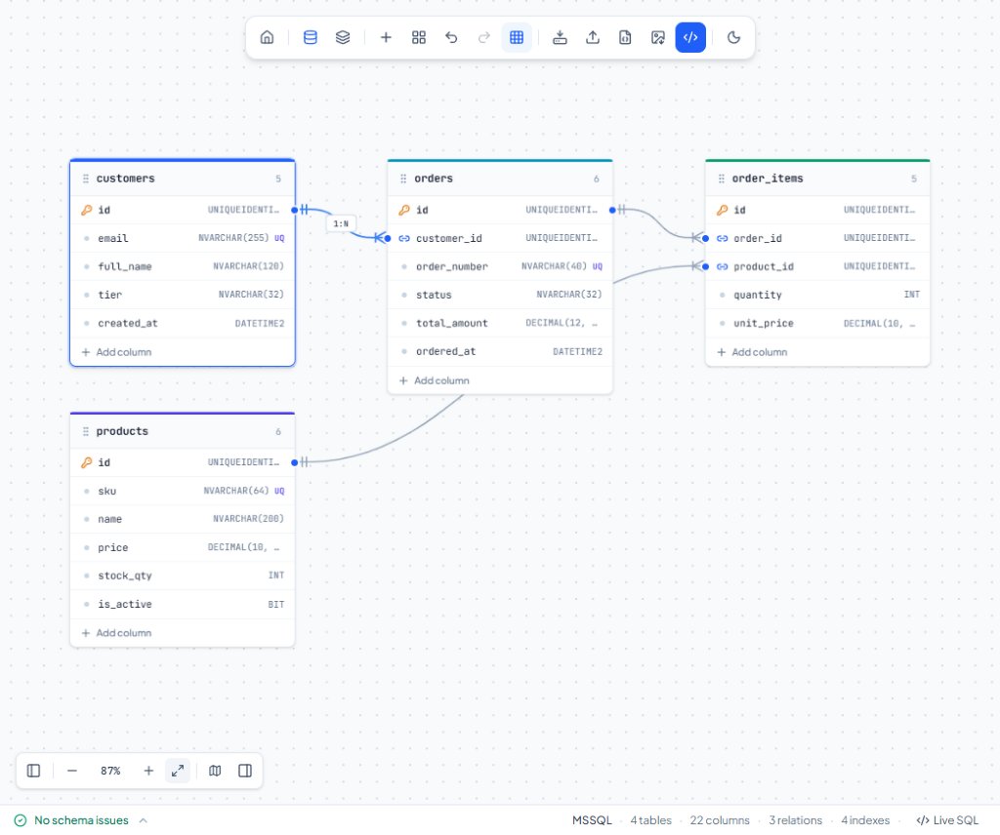
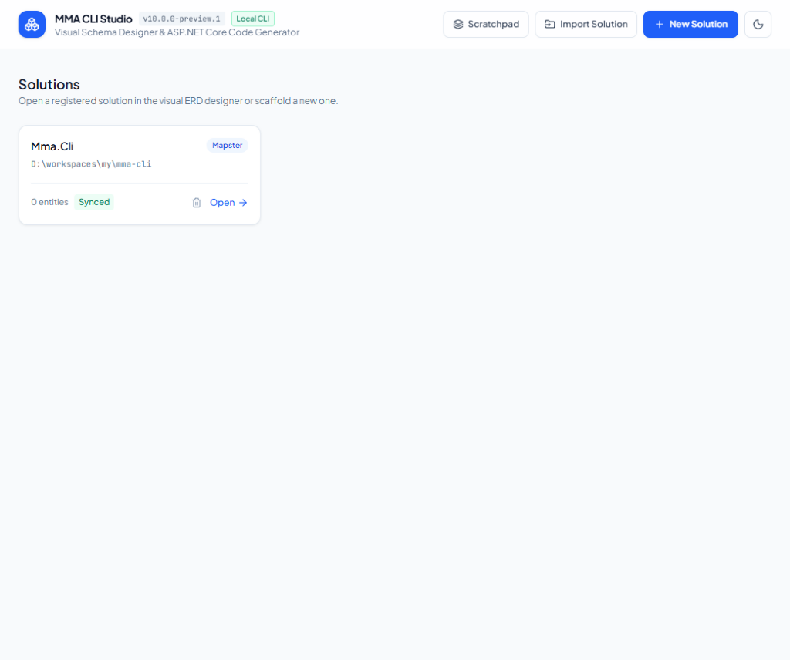
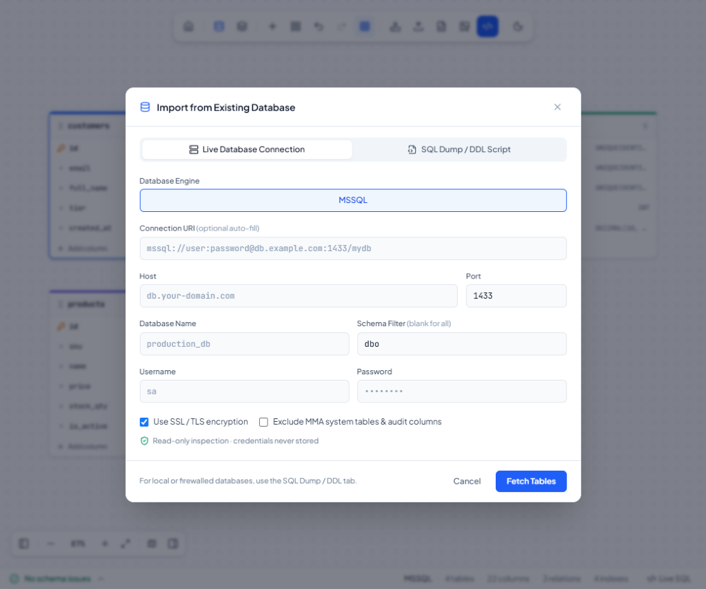
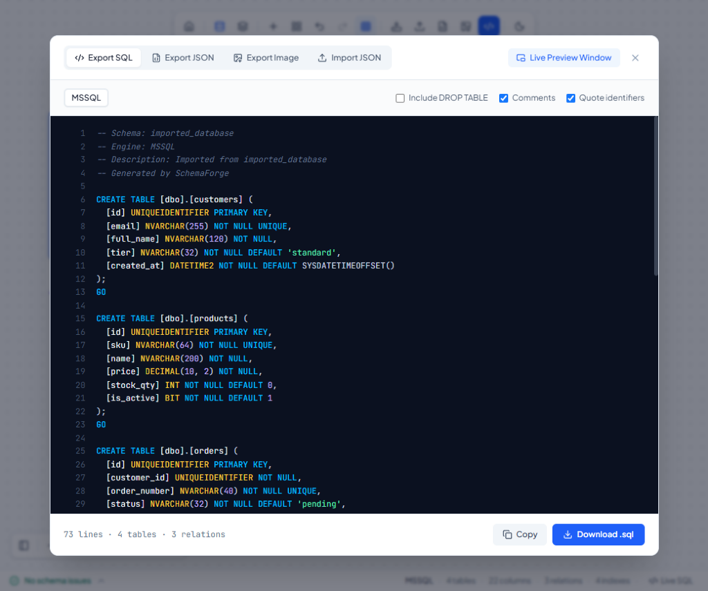

# MMA CLI

[](https://www.nuget.org/packages/mma-cli)
[](https://dotnet.microsoft.com/download/dotnet/10.0)
[](https://github.com/mma1979/mma-cli/blob/main/LICENSE)

```text
.___  ___. .___  ___.      ___
|   \/   | |   \/   |     /   \
|  \  /  | |  \  /  |    /  ^  \
|  |\/|  | |  |\/|  |   /  /_\  \
|  |  |  | |  |  |  |  /  _____  \
|__|  |__| |__|  |__| /__/     \__\
```

**MMA CLI** is a **.NET 10** code generator and visual schema designer for **ASP.NET Core** APIs. Scaffold clean solutions, design relational schemas visually in **MMA CLI Studio**, reverse-engineer existing databases, and generate entities, DTOs, validators, EF Core configurations, services, and API controllers from one local tool.



---

## What's New in v10.0.0-preview.4

- **.NET 10 Upgrade:** All CLI, shared, BFF, and test projects target `net10.0`.
- **New MMA CLI Studio (React 19 + ASP.NET Core BFF):** Replaced the legacy Blazor UI with a fast, local-first React + TypeScript web studio served by an embedded ASP.NET Core BFF with per-session token authentication and SQLite persistence.
- **Solutions Hub:** Register and open existing `.sln`/`.slnx` solutions, scaffold new `AutoMapper` or `Mapster` solutions, or experiment in standalone **Scratchpad** mode.
- **Visual ERD Designer:** Interactive drag-and-drop canvas with primary/foreign/unique key badges, composite foreign keys, indexes, check constraints, schema validation, and instant SQL/JSON/SVG/PNG export.
- **Multi-Database Reverse Engineering:** Read-only live introspection for **SQL Server**, **PostgreSQL**, and **MySQL**, plus **SQL Dump / DDL Script** import and an opt-in filter to exclude MMA system tables and audit columns.
- **Preview & Code Generation:** Dry-run diff of pending entities, properties, and relations with `Applied` sync badges, copyable `mma g ...` commands, and optional EF Core migration scaffolding.
- **Hardened CLI Launcher:** Upgraded `mma ui` with loopback port selection, `--path`, `--no-browser`, `--no-local-db`, structured error handling, and clean `Ctrl+C` shutdown.

---

## Quick Start

Install `mma-cli` as a global .NET tool (requires **.NET 10 SDK**):

```bash
dotnet tool install --global mma-cli --prerelease
```

Create a new ASP.NET Core solution:

```bash
mma new MySolution
# or short form with Mapster:
mma n MySolution --mapper mapster
```

Navigate into the solution and launch **MMA CLI Studio**:

```bash
cd MySolution
mma ui
```

---

## MMA CLI Studio (Visual UI)

```bash
mma ui
```

### `mma ui` Options

| Option | Description |
| --- | --- |
| `-p, --port <port>` | Loopback port to bind (default `5080`; pass `0` to auto-select a free port) |
| `--path <dir>` | Auto-open or import an existing `.sln`/`.slnx` solution directory |
| `--no-browser` | Start the local server without automatically opening a browser tab |
| `--no-local-db` | Disable loopback/private-network live database introspection |
| `-h, --help` | Display `mma ui` usage and examples |

### Solutions Hub



### Database Reverse Engineering & DDL Import



### Live SQL, JSON & Image Export



---

## Command-Line Reference

### Create a New Solution

```bash
mma new <SolutionName> [--mapper automapper|mapster]
mma n <SolutionName> [--mapper automapper|mapster]
```

### Generate an Entity

```bash
mma generate entity <EntityName> [PrimaryKeyType] [--mapper automapper|mapster] [--no-api]
mma g e <EntityName> [PrimaryKeyType] [--mapper automapper|mapster] [--no-api]
```

Supported data types (default: `Guid`):
`Guid`, `int`, `long`, `string`, `decimal`, `float`, `bool`, `DateTime`

- `--mapper`: `automapper` (default) or `mapster`
- `--no-api`: Skip generating the API controller for this entity

### Add or Remove a Property

```bash
mma generate property <EntityName> <PropertyName> <DataType> [IsNullable] [--remove]
mma g p <EntityName> <PropertyName> <DataType> [IsNullable] [--remove]
```

### Add or Remove a Relation

```bash
mma generate relation <ParentEntity> <ChildEntity> <ForeignKeyProperty> [--remove]
mma g r <ParentEntity> <ChildEntity> <ForeignKeyProperty> [--remove]
```

### Interactive Mode

Run `mma` with no arguments inside a solution folder to use the interactive prompt:

```bash
mma
```

---

## Links

- **Source Repository:** https://github.com/mma1979/mma-cli
- **Issues & Feedback:** https://github.com/mma1979/mma-cli/issues
