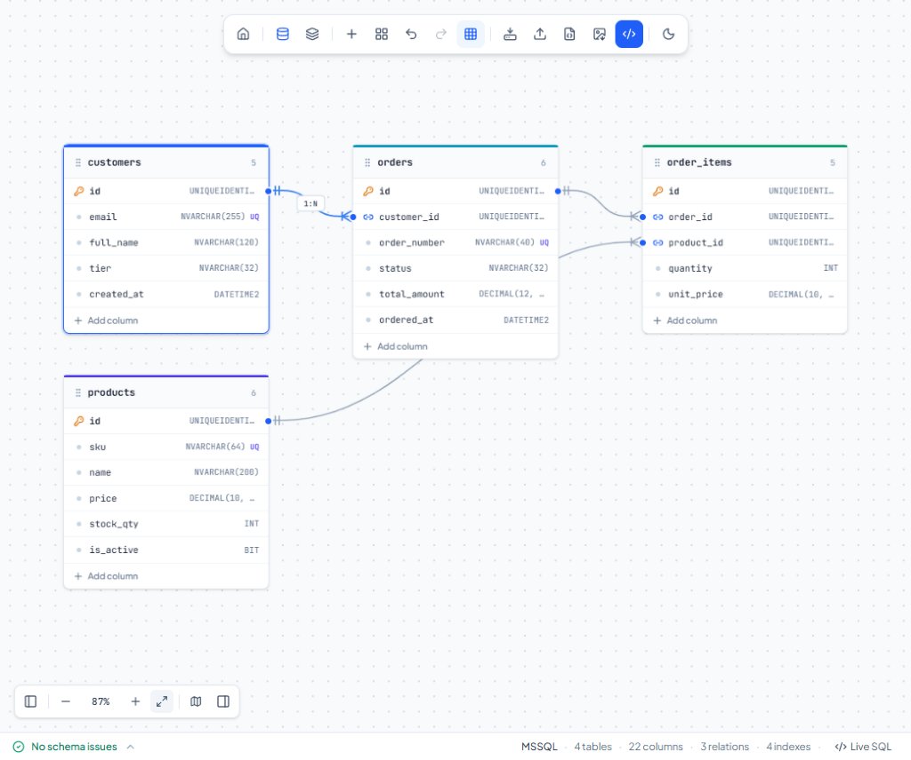

# MMA CLI Studio Client (`Mma.Cli.Web`)

React 19 + TypeScript + Vite 8 + Tailwind CSS 4 frontend for **MMA CLI Studio** (formerly SchemaForge). The canonical API host is the ASP.NET Core .NET 10 BFF in [../Mma.Cli.Bff/Mma.Cli.Bff.csproj](../Mma.Cli.Bff/Mma.Cli.Bff.csproj) (see [../README.md](../README.md) for the full CLI & Studio documentation).



## Prerequisites

- **Node.js 20.19+ or 22.12+** and **npm**
- **.NET 10 SDK** to run the local BFF host (`../Mma.Cli.Bff/Mma.Cli.Bff.csproj`)

## Local Development

1. Start the ASP.NET Core BFF on `http://localhost:5080`:

```powershell
dotnet run --project ../Mma.Cli.Bff/Mma.Cli.Bff.csproj
```

2. In a second terminal, install dependencies and start Vite:

```powershell
npm ci
npm run dev
```

Vite serves the UI on `http://localhost:5173` and proxies `/api` requests to `http://localhost:5080`.

## Production Build & Packaging

Build the frontend bundle directly into `../Mma.Cli.Bff/wwwroot`:

```powershell
npm run lint
npm run build
```

To build the React client, publish `Mma.Cli.Bff` into `Mma.Cli.AppV4/UI`, and package the `mma-cli` global tool, run the repo scripts from the solution root:

```powershell
# Build UI + publish BFF bundle
pwsh -NoProfile -File ../scripts/build-ui.ps1

# Build UI + run tests + pack mma-cli .nupkg
pwsh -NoProfile -File ../scripts/pack-tool.ps1
```

## Database Introspection Notes

- When launched via `mma ui`, local/private-network database introspection is enabled by default for local developer workflows; pass `mma ui --no-local-db` to block loopback and private-network targets.
- For firewalled or offline databases, use the **SQL Dump / DDL Script** tab in the **Import from Existing Database** modal.
