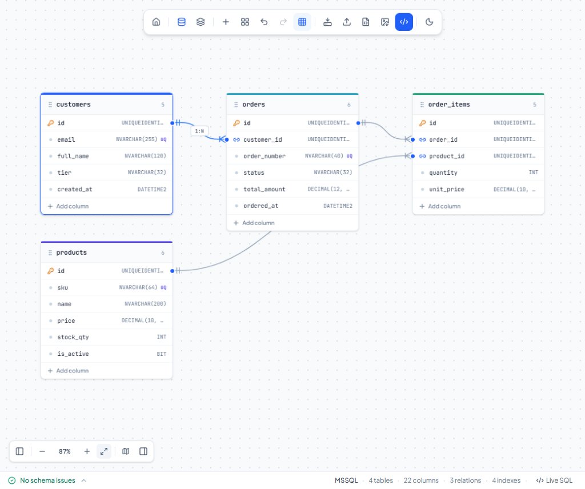
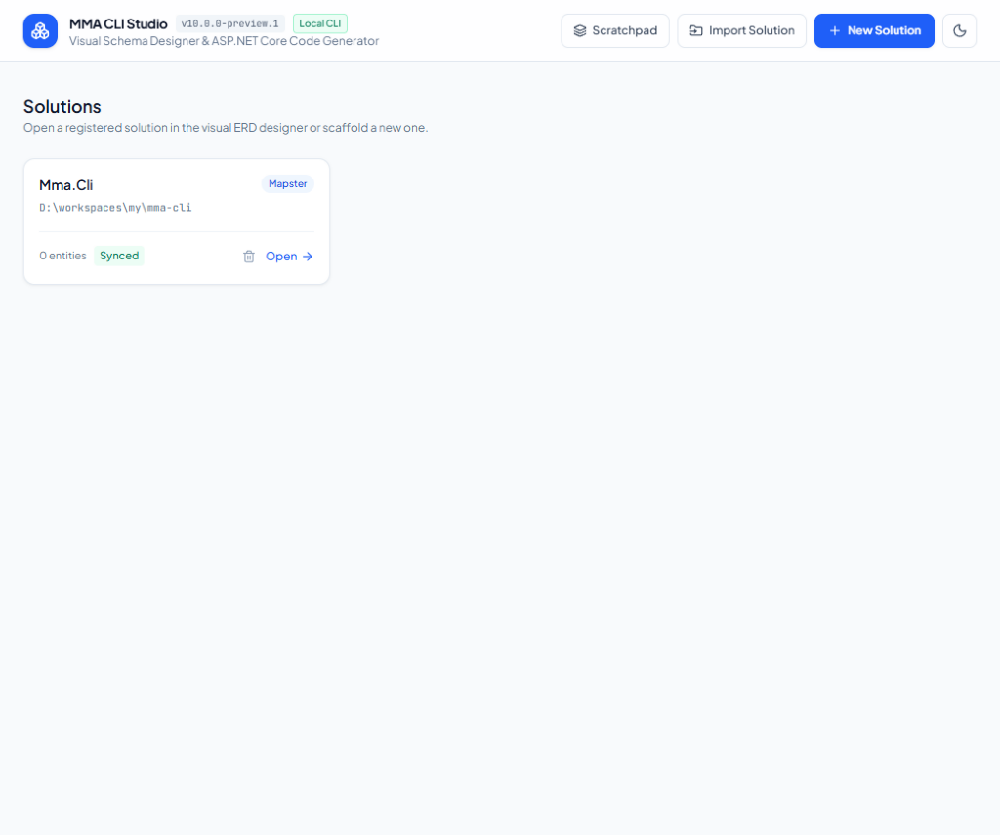
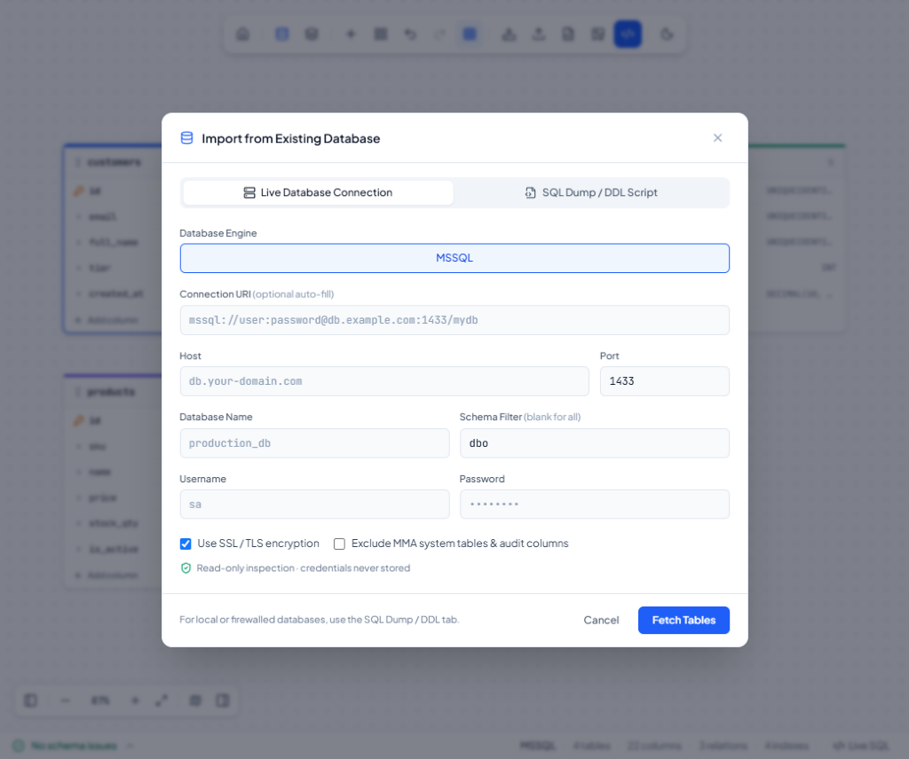
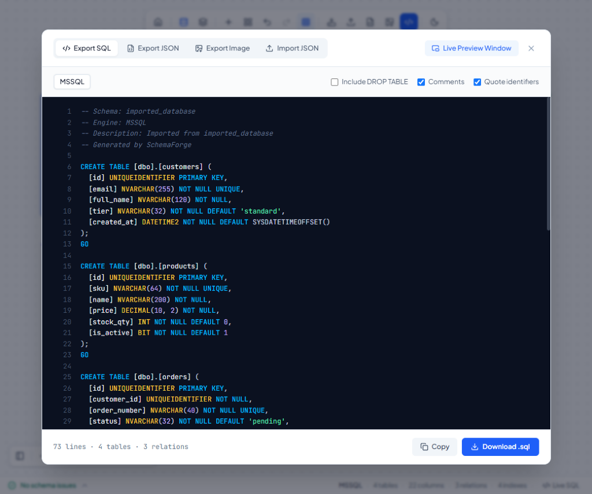
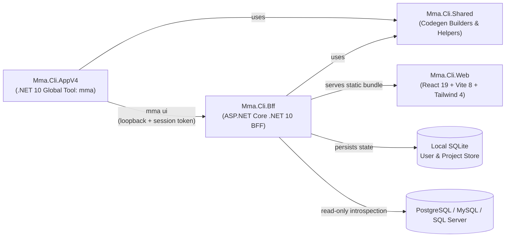

# MMA CLI

[](https://www.nuget.org/packages/mma-cli)
[](https://dotnet.microsoft.com/download/dotnet/10.0)
[](LICENSE)

```text
.___  ___. .___  ___.      ___
|   \/   | |   \/   |     /   \
|  \  /  | |  \  /  |    /  ^  \
|  |\/|  | |  |\/|  |   /  /_\  \
|  |  |  | |  |  |  |  /  _____  \
|__|  |__| |__|  |__| /__/     \__\
```

**MMA CLI** is a **.NET 10** code generator and visual schema designer for **ASP.NET Core** APIs. Scaffold clean solutions, design relational schemas visually in **MMA CLI Studio**, reverse-engineer existing databases, and generate entities, DTOs, validators, EF Core configurations, services, and API controllers from one local tool.



---

## Table of Contents

- [What's New in v10.0.0-preview.1](#whats-new-in-v1000-preview1)
- [Prerequisites](#prerequisites)
- [Quick Start](#quick-start)
- [MMA CLI Studio (Visual UI)](#mma-cli-studio-visual-ui)
- [Command-Line Reference](#command-line-reference)
- [Interactive Mode](#interactive-mode)
- [Architecture](#architecture)
- [Building & Packaging from Source](#building--packaging-from-source)

---

## What's New in v10.0.0-preview.1

- **.NET 10 Upgrade:** All CLI, shared, BFF, and test projects target `net10.0`.
- **New MMA CLI Studio (React 19 + ASP.NET Core BFF):** Replaced the legacy Blazor UI (`Mma.Cli.UI`) with a fast, local-first React + TypeScript + Vite web studio (`Mma.Cli.Web`) served by an embedded ASP.NET Core BFF (`Mma.Cli.Bff`) with per-session token authentication and SQLite persistence.
- **Solutions Hub:** Register and open existing `.sln`/`.slnx` solutions, scaffold new `AutoMapper` or `Mapster` solutions, or experiment in standalone **Scratchpad** mode.
- **Visual ERD Designer:** Interactive drag-and-drop canvas with primary/foreign/unique key badges, composite foreign keys, indexes, check constraints, schema validation, and instant SQL/JSON/SVG/PNG export.
- **Multi-Database Reverse Engineering:** Read-only live introspection for **SQL Server**, **PostgreSQL**, and **MySQL**, plus **SQL Dump / DDL Script** import and an opt-in filter to exclude MMA system tables and audit columns.
- **Preview & Code Generation:** Dry-run diff of pending entities, properties, and relations with `Applied` sync badges, copyable `mma g ...` commands, and optional EF Core migration scaffolding.
- **Hardened CLI Launcher:** Upgraded `mma ui` with loopback port selection, `--path`, `--no-browser`, `--no-local-db`, structured `MmaCliException` error handling, and clean `Ctrl+C` shutdown.

---

## Prerequisites

- [.NET 10 SDK](https://dotnet.microsoft.com/download/dotnet/10.0) (required to run `mma` and `mma ui`)
- [Node.js 20.19+ or 22.12+](https://nodejs.org/) *(only required when building `Mma.Cli.Web` from source)*

---

## Quick Start

Install `mma-cli` as a global .NET tool:

```bash
# Install the .NET 10 preview release
dotnet tool install --global mma-cli --prerelease

# Or update an existing installation
dotnet tool update --global mma-cli --prerelease
```

Create a new ASP.NET Core solution:

```bash
mma new MySolution
# or short form:
mma n MySolution --mapper mapster
```

Navigate into the solution and launch **MMA CLI Studio**:

```bash
cd MySolution
mma ui
```

---

## MMA CLI Studio (Visual UI)

Launch the local visual schema designer and code generator from any directory or inside a solution folder:

```bash
mma ui
```

### `mma ui` Options

| Option | Description |
| --- | --- |
| `-p, --port <port>` | Loopback port to bind (default `5080`; pass `0` to auto-select a free port) |
| `--path <dir>` | Auto-open or import an existing `.sln`/`.slnx` solution directory |
| `--no-browser` | Start the local server without automatically opening a browser tab |
| `--no-local-db` | Disable loopback/private-network live database introspection |
| `-h, --help` | Display `mma ui` usage and examples |

### Studio Highlights

#### 1. Solutions Hub
Manage registered solutions, inspect sync status (`Synced` / mapper badge), scaffold new solutions, import existing `.sln`/`.slnx` projects, or launch **Scratchpad** mode for standalone ERD design.



#### 2. Visual ERD Designer
Design tables, columns, primary keys, unique constraints, indexes, and `1:N` / `1:1` crow's-foot relations on an interactive pan-and-zoom canvas with live schema validation.


#### 3. Database Reverse Engineering & DDL Import
Connect directly (read-only, credentials never stored) to **SQL Server**, **PostgreSQL**, or **MySQL**—or paste a **SQL Dump / DDL Script** for local or firewalled databases—with an option to exclude MMA system tables and audit columns.



#### 4. Live SQL, JSON & Image Export
Preview and export syntax-highlighted DDL (`MSSQL`, `PostgreSQL`, `MySQL`), portable schema JSON, or SVG/PNG diagrams directly from the designer.



---

## Command-Line Reference

All commands can be run directly from your terminal inside a generated solution directory.

### 1. Create a New Solution

```bash
mma new <SolutionName> [--mapper automapper|mapster]
# Short form:
mma n <SolutionName> [--mapper automapper|mapster]
```

- `--mapper`: Object mapping library — `automapper` (default) or `mapster`.

### 2. Generate an Entity

```bash
mma generate entity <EntityName> [PrimaryKeyType] [--mapper automapper|mapster] [--no-api]
# Short form:
mma g e <EntityName> [PrimaryKeyType] [--mapper automapper|mapster] [--no-api]
```

Supported data types (default: `Guid`):
`Guid`, `int`, `long`, `string`, `decimal`, `float`, `bool`, `DateTime`

- `--mapper`: `automapper` (default) or `mapster`
- `--no-api`: Skip generating the API controller for this entity

### 3. Add or Remove a Property

```bash
mma generate property <EntityName> <PropertyName> <DataType> [IsNullable] [--remove]
# Short form:
mma g p <EntityName> <PropertyName> <DataType> [IsNullable] [--remove]
```

Examples:

```bash
mma g p Order TotalAmount decimal
mma g p Order Notes string true
mma g p Order Notes string true --remove
```

### 4. Add or Remove a Relation

```bash
mma generate relation <ParentEntity> <ChildEntity> <ForeignKeyProperty> [--remove]
# Short form:
mma g r <ParentEntity> <ChildEntity> <ForeignKeyProperty> [--remove]
```

Examples:

```bash
mma g r Customer Order CustomerId
mma g r Customer Order CustomerId --remove
```

### 5. Utility Commands

```bash
mma --version   # or: mma -v
mma --help      # or: mma -h
```

---

## Interactive Mode

Run `mma` with no arguments to launch the guided terminal prompt for creating solutions, adding/removing entities, properties, and relations, starting `mma ui`, or running watch mode:

```bash
mma
```

---

## Architecture



| Project | Purpose |
| --- | --- |
| `Mma.Cli.AppV4` | `.NET 10` global tool entry point (`mma`) and `UiLauncher` |
| `Mma.Cli.Shared` | Solution, entity, property, and relation codegen builders |
| `Mma.Cli.Bff` | Local ASP.NET Core BFF for schema sync, DB introspection, filesystem, and codegen orchestration |
| `Mma.Cli.Web` | React 19 + TypeScript + Vite 8 visual ERD studio (see [Mma.Cli.Web/README.md](Mma.Cli.Web/README.md)) |
| `Mma.Cli.Shared.Tests` & `Mma.Cli.Bff.Tests` | Automated `.NET 10` test suites |

---

## Building & Packaging from Source

### Build the Web UI and Publish the BFF Bundle

```powershell
pwsh -NoProfile -File scripts/build-ui.ps1
```

### Run All Tests and Pack the Global Tool (`.nupkg`)

```powershell
pwsh -NoProfile -File scripts/pack-tool.ps1
```

This script builds `Mma.Cli.Web`, publishes `Mma.Cli.Bff` into `Mma.Cli.AppV4/UI`, runs `Mma.Cli.Shared.Tests` and `Mma.Cli.Bff.Tests`, and outputs the `.nupkg` package under `Mma.Cli.AppV4/nupkg/`.

---

## License

This project is licensed under the terms of the [LICENSE](LICENSE) file.
