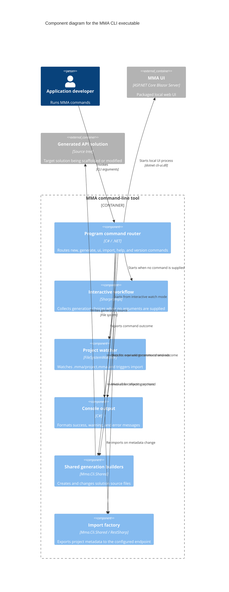

# CLI component diagram

This diagram shows the internal components of the `Mma.Cli.AppV4` executable. It concentrates on command dispatch and user-facing execution modes.

## Command routing

`Program` is the composition root. It calls `SolutionBuilder` for new solutions; `EntityBuilder`, `PropertiesBuilder`, and `RelationsBuilder` for incremental updates; `ImportFactory` for export; and `CliWrap` for launching the packaged UI.
