# Shared generation component diagram

The shared library holds the generator's reusable domain logic. These are components within a library, not independently deployable containers.

```mermaid
C4Component
  title Component diagram for Mma.Cli.Shared generation

  Container_Ext(cli, "MMA command-line tool", ".NET console application", "Invokes shared generation components")
  Container_Ext(ui, "MMA UI", "Blazor Server application", "Invokes shared generation components")
  Container_Ext(solution, "Generated API solution", "Source tree", "Receives generated code and .mma state")
  System_Ext(generatorApi, "Generator API", "HTTP API", "Receives exported metadata")

  Container_Boundary(shared, "Mma.Cli.Shared") {
    Component(solutionBuilder, "SolutionBuilder", "C#", "Extracts embedded starter archives and renames solution content")
    Component(entityBuilder, "EntityBuilder", "C#", "Generates models, validation, entity, config, service, and controller")
    Component(propertyBuilder, "PropertiesBuilder", "C#", "Updates models, entity, and configuration for a property")
    Component(relationBuilder, "RelationsBuilder", "C#", "Updates DTOs, entities, and configuration for a relation")
    Component(templateHelper, "TemplateHelper", "C#", "Selects default or .mma template overrides")
    Component(buildHelper, "BuildHelper", "C#", "Finds solution layout and detects mapper choice")
    Component(configHelper, "ConfigHelper", "C# / Newtonsoft.Json", "Reads local or global generator configuration")
    Component(importFactory, "ImportFactory", "RestSharp", "Serializes .mma project state and posts it")
    Component(embeddedTemplates, "Embedded templates and archives", "Resources / C# templates", "Starter solutions and mapper-specific code templates")
  }

  Rel(cli, solutionBuilder, "Scaffolds solution with")
  Rel(cli, entityBuilder, "Generates entity with")
  Rel(ui, entityBuilder, "Applies entity change with")
  Rel(ui, propertyBuilder, "Applies field change with")
  Rel(ui, relationBuilder, "Applies relation change with")
  Rel(solutionBuilder, embeddedTemplates, "Extracts starter archive from")
  Rel(solutionBuilder, solution, "Creates solution and metadata", "File system")
  Rel(entityBuilder, templateHelper, "Loads templates through")
  Rel(propertyBuilder, templateHelper, "Loads templates through")
  Rel(relationBuilder, templateHelper, "Loads templates through")
  Rel(templateHelper, embeddedTemplates, "Falls back to default templates")
  Rel(templateHelper, solution, "Reads optional template override", "File system")
  Rel(entityBuilder, buildHelper, "Discovers target paths through")
  Rel(propertyBuilder, buildHelper, "Discovers target paths through")
  Rel(relationBuilder, buildHelper, "Discovers target paths through")
  Rel(entityBuilder, solution, "Writes and amends source", "File system")
  Rel(propertyBuilder, solution, "Amends source", "File system")
  Rel(relationBuilder, solution, "Amends source", "File system")
  Rel(importFactory, configHelper, "Reads GeneratorEndpoint from")
  Rel(importFactory, solution, "Reads .mma/project.mma", "File system")
  Rel(importFactory, generatorApi, "Posts project definition", "JSON/HTTPS")
```

## Extensibility points

- Mapper selection chooses the AutoMapper or Mapster archive/template set.
- A generated solution can override an individual template with `.mma/templates/<mapper>/<TemplateName>.cs`.
- `GeneratorEndpoint` is read first from the solution-local `.mma/config.json`, then from the user's global `.mma/config.json`.
