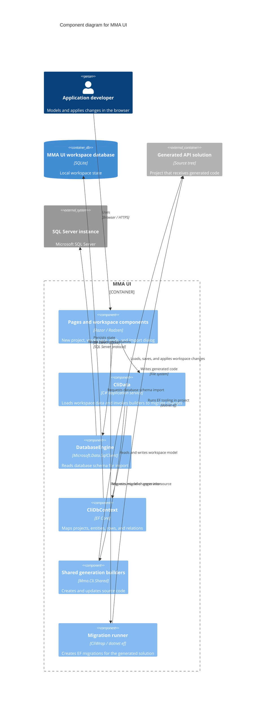

# UI component diagram

The UI is a local Blazor Server application. It lets users model projects visually, persist the working model in SQLite, inspect an existing SQL Server database, and apply the shared code-generation builders to a generated solution.

## Local state model

`CliDbContext` stores `ProjectModel`, `EntityModel`, `EntityRowModel`, and `RelationModel`. Its relationship configuration cascades deletes from projects to their entities and from entities to fields and relations.
