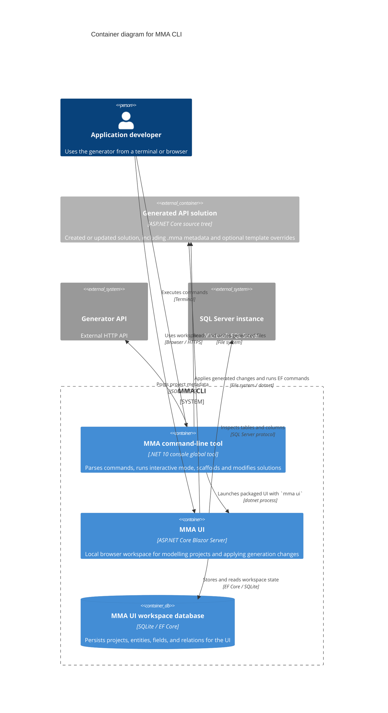

# Container diagram

MMA CLI is packaged as one .NET tool. Its Blazor Server UI is a separately built executable distributed inside that tool and launched on demand. The shared project is a code library, so it is intentionally represented as an internal implementation detail in component diagrams rather than as a C4 container.

## Container responsibilities

| Container | Responsibility |
| --- | --- |
| MMA command-line tool | Command dispatch, interactive prompts, source generation, watches `.mma/project.mma`, and starts the UI. |
| MMA UI | Browser workflow for project modelling, database-first import, migration application, and generator invocation. |
| MMA UI workspace database | Local-only state for UI projects, entities, entity rows, and relations. |
| Generated API solution | The consumer-owned codebase modified by generator builders. |
