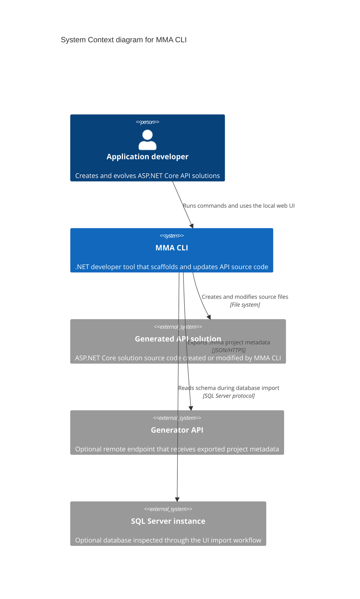

# System context

MMA CLI lets an application developer scaffold an ASP.NET Core solution and evolve its domain model through terminal, interactive, or browser-based workflows.

## Relationships

- The developer uses `mma new`, `mma generate`, `mma import`, interactive prompts, or `mma ui`.
- Generated solutions contain the API projects and source files that the tool scaffolds; they are not part of MMA CLI's runtime.
- Project metadata is retained in the generated solution's `.mma` directory and can be exported to the externally hosted Generator API.
- The UI can inspect a SQL Server schema to create its local workspace model before applying generation changes.
