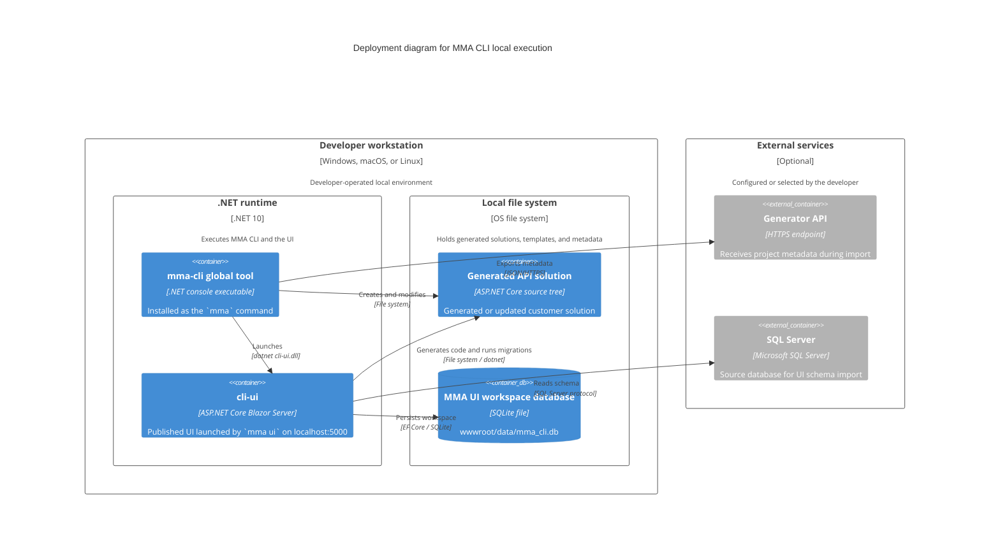

# Deployment diagram

This diagram shows the deployment topology supported directly by the repository: a .NET global tool executing on a developer workstation and launching a packaged local UI. No production deployment definition is present in this codebase.

## Packaging and operational notes

- `Mma.Cli.AppV4` is packaged as a .NET tool with command name `mma`.
- The UI project is published into the CLI distribution's `UI` directory and executed as `dotnet cli-ui.dll`.
- The UI persists its own workspace database locally; generated projects retain independent `.mma` metadata in their own root directories.
- Hosting the UI remotely, deploying the Generator API, authentication, TLS termination, observability, backups, and network policy are not specified by this repository.
