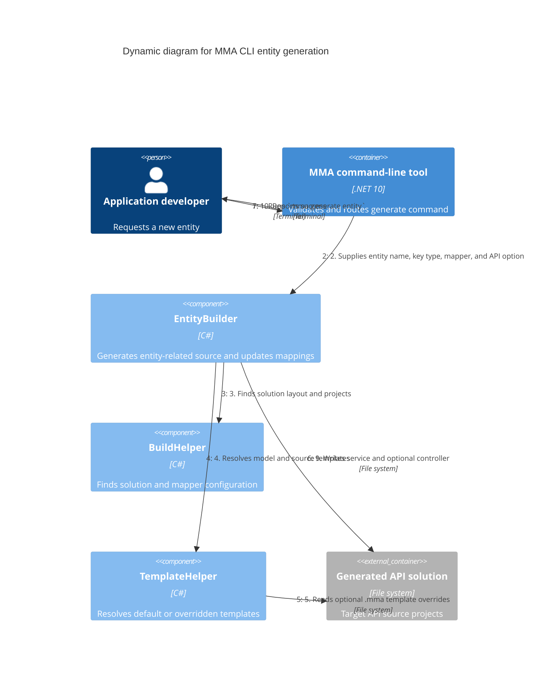

# Dynamic diagram: entity generation

This diagram covers the `mma generate entity` flow; interactive mode and the UI invoke the same underlying `EntityBuilder` sequence.

For AutoMapper output, entity generation also updates the mapping profile. The `--no-api` option omits controller generation.
