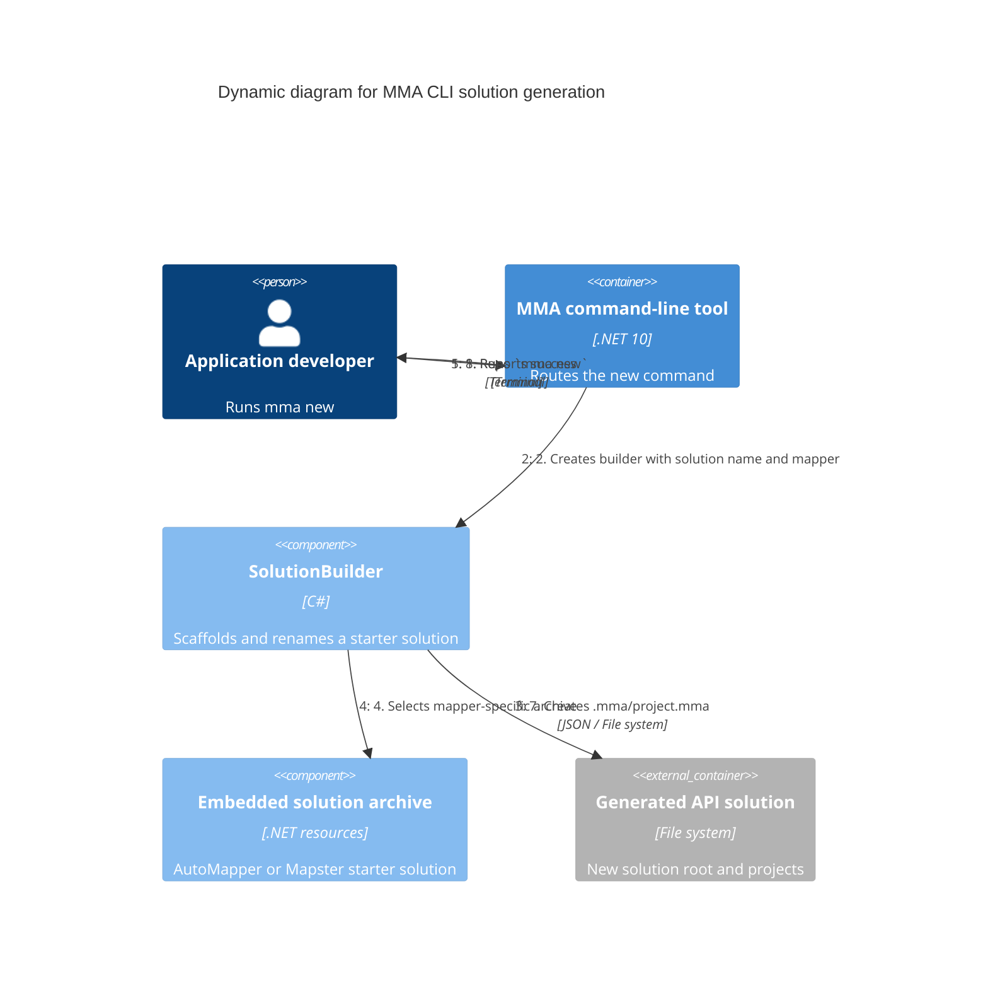

# Dynamic diagram: solution generation

This is the observed `mma new <SolutionName> --mapper <automapper|mapster>` flow. It describes file operations only; no network service is required.

The builder writes a `.mma` directory containing project metadata. Subsequent UI and import workflows use that state.
