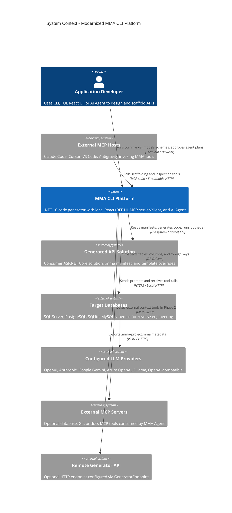
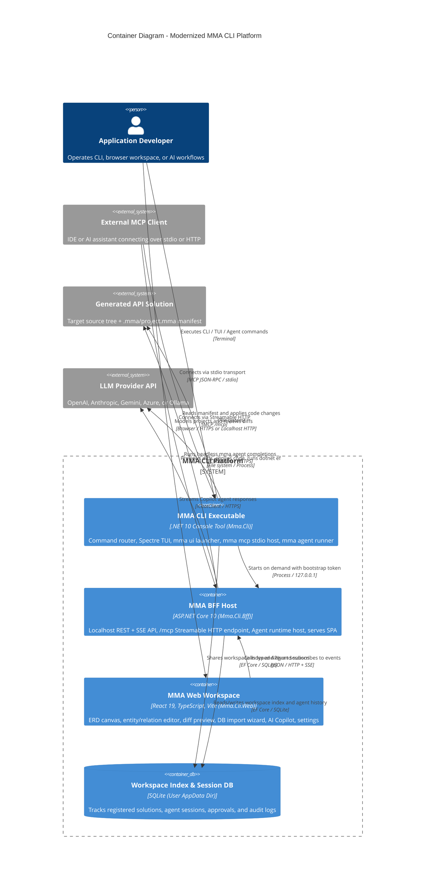
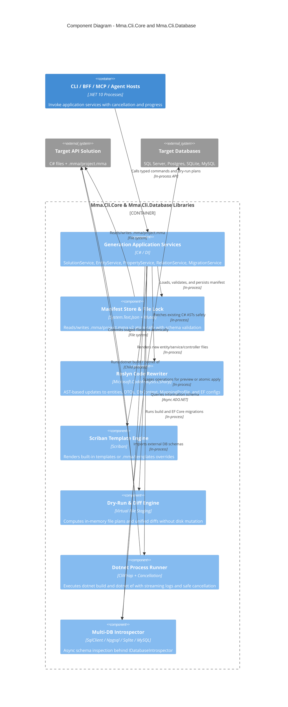
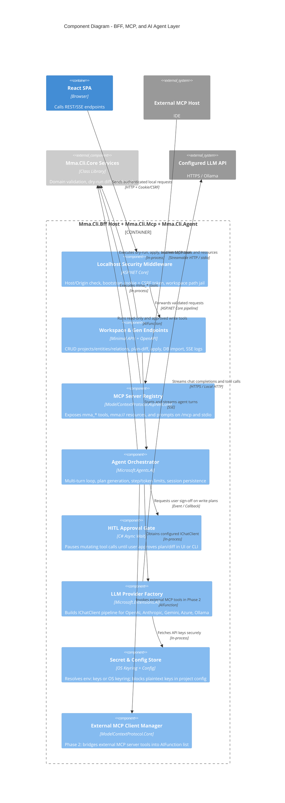
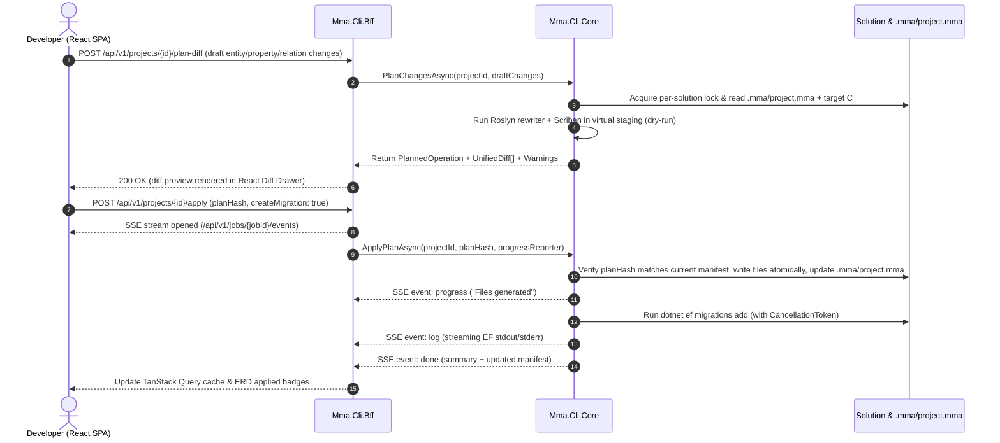
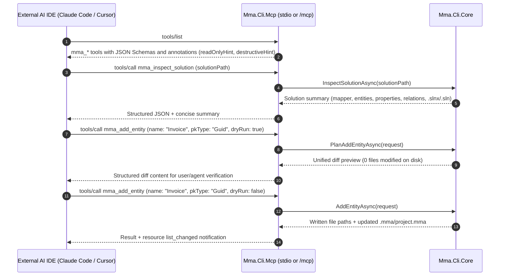
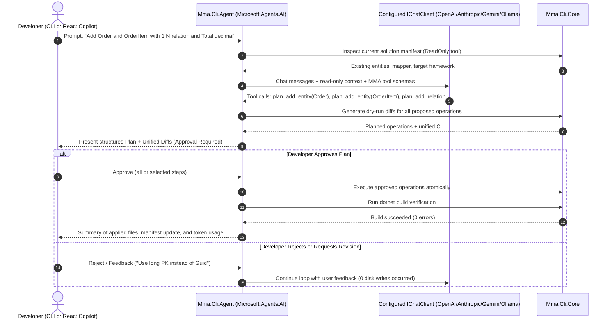
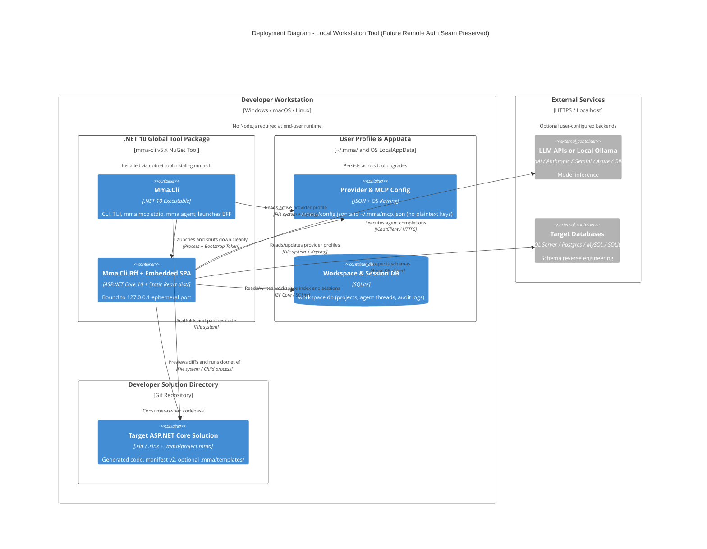

# 02 — Target C4 & Dynamic Architecture

> **Epistemic Status**: Target-state diagrams and project layout represent **Recommendations** aligned with the **Verified Facts** of the existing `.NET 10` repository (`Mma.Cli.sln`) and agreed **Assumptions** (`CONTEXT.md`). Every diagram follows C4 modeling rules: shared class libraries (`Mma.Cli.Core`, `Mma.Cli.Database`, `Mma.Cli.Mcp`, `Mma.Cli.Agent`) are modeled as **Components inside runtime Containers**, never as standalone C4 Containers.

---

## 1. Level 1 — System Context Diagram

Shows MMA CLI as a cohesive platform interacting with developers, external AI clients, target solutions, databases, configurable LLM providers, external MCP servers, and the optional legacy Generator API.



---

## 2. Level 2 — Container Diagram

Three deployable/executable runtime units plus local persistence comprise the **MMA CLI Platform**, packaged into one `.NET 10` global tool (`mma-cli`):



### Container Responsibilities

| Container | Runtime | Responsibility |
| --- | --- | --- |
| **MMA CLI Executable (`Mma.Cli`)** | `.NET 10` Global Tool (`mma`) | `System.CommandLine` v2 command routing, `Spectre.Console` interactive TUI, `mma mcp` stdio server, `mma agent` CLI runner, and `mma ui` BFF launcher. |
| **MMA BFF Host (`Mma.Cli.Bff`)** | `ASP.NET Core 10` (`127.0.0.1`) | Owns localhost security, REST API (`/api/v1/*`), SSE streaming, Streamable HTTP MCP (`/mcp`), Agent session execution, and static hosting of the prebuilt React bundle. |
| **MMA Web Workspace (`Mma.Cli.Web`)** | Prebuilt `React 19 + TS` SPA | Browser workspace: solution explorer, interactive React Flow ERD, property/relation grid, dry-run unified diff viewer, DB import wizard, AI Copilot drawer, and provider settings. |
| **Workspace Index & Session DB** | `SQLite` in OS AppData | Stores known solution paths, recent workspaces, AI Agent conversations, approval history, and execution telemetry (never stored in `wwwroot/`). |

---

## 3. Level 3 — Component Diagrams

### 3.1 `Mma.Cli.Core` & `Mma.Cli.Database` (Headless Generation Engine)

Embedded as class libraries inside both `Mma.Cli` and `Mma.Cli.Bff`. Contains **zero** `Console.*`, `Environment.Exit`, `HttpContext`, or UI framework dependencies.



### 3.2 `Mma.Cli.Bff`, `Mma.Cli.Mcp`, and `Mma.Cli.Agent` (Web, MCP & AI Host)



---

## 4. Dynamic Request Flows (Sequence Diagrams)

### 4.1 Flow A — React BFF Modeling -> Dry-Run Diff -> Atomic Apply & Streaming Migration



### 4.2 Flow B — External AI IDE via MCP Server (`stdio` or `/mcp`)



### 4.3 Flow C — AI Agent Mode with Configurable Providers & HITL Approval



---

## 5. Level 4 — Target Deployment Diagram



---

## 6. Target Solution & Repository Structure

> **Verified Constraint**: `.gitignore:35` ignores `[Uu]i/`. Do **not** name the new React project `ui/` or `UI/`. Use `src/Mma.Cli.Web` and `src/Mma.Cli.Bff`.

```text
Mma.Cli.sln (or Mma.Cli.slnx)
├── Directory.Packages.props                 # Central Package Management (pins SQLite, Roslyn, MEAI, MCP versions)
├── Directory.Build.props                    # Shared net10.0, Nullable, Analyzers, TreatWarningsAsErrors (incremental)
├── .github/workflows/
│   ├── ci.yml                               # dotnet build + test + vitest + Playwright + vulnerability scan
│   └── release.yml                          # Cross-platform build, React bundle, NuGet pack/publish
└── src/
    ├── Mma.Cli.Core/                        # Headless engine: Services, Roslyn rewriters, Scriban, Manifest v2, DryRunDiff
    ├── Mma.Cli.Database/                    # Multi-DB introspection (SqlClient, Npgsql, Sqlite, MySqlConnector) + Workspace SQLite store
    ├── Mma.Cli.Mcp/                         # Shared MCP Server tools, resources, prompts + Phase 2 McpClientManager
    ├── Mma.Cli.Agent/                       # Microsoft.Extensions.AI + Microsoft.Agents.AI orchestrator, providers, secrets, HITL
    ├── Mma.Cli.Bff/                         # ASP.NET Core 10 BFF: OpenAPI REST + SSE + /mcp + serves built React SPA from wwwroot/
    ├── Mma.Cli.Web/                         # React 19 + TypeScript + Vite 6 + Tailwind + shadcn/ui + React Flow ERD
    ├── Mma.Cli.App/                         # CLI global tool ('mma'): System.CommandLine v2 + Spectre.Console + launchers
    └── tests/
        ├── Mma.Cli.Core.Tests/              # Characterization, Roslyn/Scriban golden tests, manifest lock, dry-run tests
        ├── Mma.Cli.Mcp.Tests/               # MCP protocol contract tests + 10-question read-only eval suite
        ├── Mma.Cli.Agent.Tests/             # Deterministic mock-IChatClient agent loop, approval gate, redaction tests
        └── Mma.Cli.Bff.Tests/               # WebApplicationFactory integration tests + security/origin/CSRF tests
```

### Dependency Direction Rules (Clean Architecture Invariant)

- `Mma.Cli.Core` **depends on nothing UI/HTTP/CLI/AI-specific** (only Roslyn, Scriban, `System.Text.Json`, `CliWrap`, `Microsoft.Extensions.Logging.Abstractions`).
- `Mma.Cli.Database` depends on `Mma.Cli.Core` (contracts) and database drivers.
- `Mma.Cli.Mcp` depends on `Mma.Cli.Core`, `Mma.Cli.Database`, and `ModelContextProtocol`.
- `Mma.Cli.Agent` depends on `Mma.Cli.Core`, `Mma.Cli.Database`, `Mma.Cli.Mcp` (for MCP client bridge), `Microsoft.Extensions.AI`, `Microsoft.Agents.AI`, and provider SDKs.
- `Mma.Cli.Bff` and `Mma.Cli.App` are **composition roots** wiring DI, configuration, and transport hosting.
