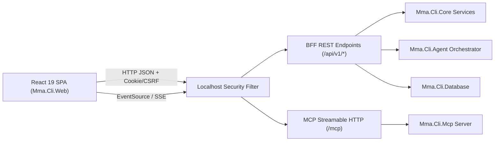

# 04 — Technical Specification: React + BFF UI Redesign

> **Epistemic Status**: Legacy behavior is grounded in **Verified Facts** from `Mma.Cli.UI` and `Mma.Cli.AppV4/Program.cs`. The React + ASP.NET Core 10 BFF design reflects agreed **Assumptions** (local-first `.NET` global tool with zero end-user Node.js requirement, remote-ready seam) and architectural **Recommendations**.

---

## 1. Feature Parity & Upgrade Matrix

| Legacy Blazor / Radzen Screen | Verified Legacy Issues | Modern React + BFF Equivalent | UX & Architectural Upgrades |
| --- | --- | --- | --- |
| `Pages/Index.razor` (Project list) | Reads `wwwroot\data\mma_cli.db` directly via injected `CliDbContext` | **Workspace Hub** (`/`) | Unified workspace cards showing `.mma/project.mma` status, drift badge, quick-open recent solutions, and `Register Existing Solution` picker |
| `Pages/NewProject.razor` (`/new-solution`, `/import-solution`) | Windows-only `\\` path slicing (`NewProject.razor:129-138`); shells out via `Cli.Wrap("mma")` (`lines 181, 221`) | **New Solution & Open/Import Modal + Server Directory Browser** | Cross-platform `/api/v1/fs/browse` directory picker, mapper selection (`AutoMapper` / `Mapster` / future `Mapperly`), optional initial `dotnet ef` migration with live log stream |
| `Pages/Workspace.razor` + `EntityGrid.razor` + `ProjectWorkspace.razor` | Concurrent `ForEach(async ...)` DB corruption (`lines 420-447`); `!e.Applied` skips edits on applied entities (`line 415`); un-scoped `EntityName` lookup (`line 629`) | **Dual-Mode Solution Studio** (`/projects/:projectId`) | Switch seamlessly between **Interactive ERD Canvas** (`@xyflow/react`) and **Tabular Entity Inspector**, plus **Dry-Run Unified Diff Drawer** before applying changes |
| `Pages/Workspace.razor` Relations Dialog + empty `RelationsManager.razor` | Inline Radzen modal grid; removes via `Cli.Wrap("mma")` while adds call `CliData` | **Visual Relation Edge Editor + Relation Matrix** | Draw 1:N (and future 1:1 / M:N) edges directly on ERD canvas, configure FK property, nullability, and `DeleteBehavior` |
| `Pages/ImportDatabaseDialog.razor` + `Data/DatabaseEngine.cs` | SQL Server-only sync `SqlDataAdapter`; forces `TrustServerCertificate=true`; maps Windows Auth to `ActiveDirectoryIntegrated` (`lines 85-87`) | **Multi-Step Database Import Wizard** | Supports SQL Server, PostgreSQL, SQLite, and MySQL; test connection, preview detected tables/FKs/exclusions, edit entity names before applying |
| *Missing in legacy UI* | No template editor, diff preview, streaming terminal, AI assistant, or provider config | **Diff Preview, Streaming Console, Template Viewer, AI Copilot Drawer & Settings** | Real-time SSE build/migration console, `.mma/templates/` override preview, AI Agent Copilot with diff approval cards, and Provider/MCP settings |

---

## 2. BFF Architecture & API Contract (`Mma.Cli.Bff`)

The BFF runs as an ASP.NET Core 10 Minimal API host inside `Mma.Cli.Bff`. The React browser client **never** communicates directly with SQLite, target databases, the local filesystem, or LLM provider endpoints; all sensitive state, secrets, and mutations stay inside the BFF.



### 2.1 REST & SSE Endpoint Catalog (`/api/v1/...`)

All error responses conform to **RFC 9457 `ProblemDetails`** (`application/problem+json`) with an `errorCode` extension (`SOLUTION_NOT_FOUND`, `MANIFEST_CONFLICT`, `VALIDATION_ERROR`, `PATH_OUTSIDE_ALLOWLIST`, `SECRET_MISSING`).

| Group | Method & Route | Purpose |
| --- | --- | --- |
| **Session & Health** | `POST /api/v1/auth/bootstrap` | Exchanges one-time CLI launch token for `HttpOnly; SameSite=Strict` session cookie + CSRF token |
| | `GET /api/v1/health` | Returns BFF version, `.NET` SDK status, `dotnet-ef` availability, and uptime |
| **Workspaces & Filesystem** | `GET /api/v1/fs/browse?path=...` | Cross-platform directory listing constrained to configured root allow-list |
| | `GET /api/v1/workspaces` | Lists registered solutions from `workspace.db` with manifest sync status |
| | `POST /api/v1/workspaces/register` | Registers an existing solution path (reads `.sln`/`.slnx` & `.mma/project.mma`) |
| | `POST /api/v1/workspaces` | Creates a new solution (`SolutionService`) + optionally creates initial EF migration |
| | `POST /api/v1/workspaces/{id}/export` | Exports `.mma/project.mma` to configured `GeneratorEndpoint` (`ImportFactory` replacement) |
| **Schema Model** | `GET /api/v1/projects/{id}` | Returns full unified manifest (entities, properties, relations, mapper, drift check) |
| | `POST /api/v1/projects/{id}/entities` | Adds or updates a draft entity in `.mma/project.mma` |
| | `DELETE /api/v1/projects/{id}/entities/{entityName}` | Marks entity for removal or removes unapplied draft entity |
| | `POST /api/v1/projects/{id}/entities/{entityName}/properties` | Adds/updates a property on an entity (applied or unapplied) |
| | `DELETE /api/v1/projects/{id}/entities/{entityName}/properties/{prop}` | Schedules property removal |
| | `POST /api/v1/projects/{id}/relations` | Creates a relation between two project-scoped entities |
| | `DELETE /api/v1/projects/{id}/relations/{relationName}` | Schedules relation removal |
| **Plan, Apply & Migrations** | `POST /api/v1/projects/{id}/plan-diff` | Runs `DryRunDiffEngine` in memory; returns `planHash`, affected files, and unified diffs |
| | `POST /api/v1/projects/{id}/apply` | Acquires per-solution lock, applies pending changes atomically (`planHash` checked), returns `jobId` |
| | `POST /api/v1/projects/{id}/migrations` | Runs `dotnet ef migrations add` (or `script --idempotent`) asynchronously, returns `jobId` |
| | `POST /api/v1/projects/{id}/build` | Runs `dotnet build` on target solution, returns `jobId` |
| | `GET /api/v1/jobs/{jobId}/events` | **SSE stream** delivering live `progress`, `log`, `done`, and `error` events |
| **Database Import** | `POST /api/v1/db-import/test` | Tests connection string or structured credentials across SQL Server/Postgres/SQLite/MySQL |
| | `POST /api/v1/db-import/introspect` | Returns discovered tables, columns, FKs, and proposed singular entity names (read-only) |
| | `POST /api/v1/projects/{id}/db-import/apply` | Imports selected tables into manifest + runs dry-run/apply |
| **Templates** | `GET /api/v1/projects/{id}/templates` | Lists active templates (embedded vs. `.mma/templates/` overrides) |
| | `PUT /api/v1/projects/{id}/templates/{mapper}/{name}` | Saves a custom `.mma/templates/` override with syntax validation |
| **AI Agent & Config** | `GET /api/v1/providers` | Lists configured provider profiles (never returns raw API keys; returns `hasSecret: true/false`) |
| | `PUT /api/v1/providers/{profileId}` | Saves provider config (routes secrets to OS Keyring or verifies `env:` reference) |
| | `POST /api/v1/providers/{profileId}/test` | Sends minimal health ping to verify provider connectivity and model availability |
| | `GET /api/v1/mcp/servers` / `PUT /api/v1/mcp/servers` | Lists/configures external MCP servers for Phase 2 Agent Client |
| | `POST /api/v1/agent/sessions` | Starts or resumes an AI Agent session bound to a `projectId` |
| | `POST /api/v1/agent/sessions/{sessionId}/messages` | Submits prompt and opens **SSE stream** (`token`, `tool_call`, `diff`, `approval_required`, `done`) |
| | `POST /api/v1/agent/sessions/{sessionId}/approvals/{approvalId}` | Approves, partially approves, or rejects a pending agent mutation plan |

### 2.2 Server-Sent Events (SSE) Envelope Contract

```json
{
  "eventId": "evt_01J...",
  "timestamp": "2026-11-20T20:55:00Z",
  "type": "approval_required",
  "jobOrSessionId": "sess_123",
  "payload": {
    "approvalId": "appr_456",
    "planHash": "sha256:9f82...",
    "summary": "Create Order and OrderItem entities + 1:N relation",
    "operations": [
      { "kind": "add_entity", "entity": "Order", "pkType": "Guid" }
    ],
    "diffs": [
      { "path": "MyApp.Core/Database/Tables/Order.cs", "changeType": "create", "unifiedDiff": "..." }
    ]
  }
}
```

### 2.3 OpenAPI-First Type Generation

- `Mma.Cli.Bff` enables ASP.NET Core 10 built-in OpenAPI generation (`builder.Services.AddOpenApi()` and `app.MapOpenApi()` in development/build).
- An npm script in `Mma.Cli.Web` (`npm run generate:api`) executes `openapi-typescript` against the exported OpenAPI JSON schema to regenerate `src/api/schema.d.ts` and typed `openapi-fetch` helpers, guaranteeing compile-time contract sync between C# DTOs and React TypeScript components.

---

## 3. React Frontend Architecture (`Mma.Cli.Web`)

### 3.1 Tech Stack

- **Core**: React 19 + TypeScript 5 (`strict: true`) + Vite 6.
- **UI & Styling**: Tailwind CSS + shadcn/ui (Radix UI primitives) + Lucide icons + dark/light system theme.
- **Server State**: TanStack Query v5 (caching, optimistic UI updates, SSE stream invalidation).
- **Client UI State**: Zustand (active selection, drawer visibility, ERD viewport coordinates, unsaved draft filters).
- **Visual ERD Canvas**: `@xyflow/react` (React Flow) + `@dagrejs/dagre` (automatic ERD node layout) + custom Entity Node cards showing PK badge, columns, FK icons, and `Draft` / `Applied` / `Modified` status pills.
- **Diff & Code Viewer**: `@monaco-editor/react` (or lightweight `react-diff-view` / Shiki diff renderer to keep bundle compact inside `mma-cli` NuGet package — *recommended*: `shiki` + `diff` for <300 KB gzipped bundle size).
- **Testing**: Vitest + React Testing Library (unit/component) + Playwright (`webapp-testing`) against live `Mma.Cli.Bff`.

### 3.2 Directory Layout (`src/Mma.Cli.Web/`)

```text
src/Mma.Cli.Web/
├── package.json
├── vite.config.ts
├── tsconfig.json
└── src/
    ├── api/
    │   ├── client.ts                # Typed fetch wrapper + CSRF header + SSE helper
    │   └── schema.d.ts              # Generated from BFF OpenAPI spec
    ├── stores/
    │   └── workspaceStore.ts        # Active tab (ERD vs Grid), open drawers, selection
    ├── components/
    │   ├── ui/                      # shadcn/ui primitives
    │   ├── layout/                  # AppShell, TopBar, CommandPalette (Cmd+K), StatusBar
    │   └── shared/                  # UnifiedDiffViewer, LogTerminal, ApprovalBanner
    └── features/
        ├── projects/                # WorkspaceHub, NewSolutionModal, DirectoryPickerModal
        ├── erd/                     # ErdCanvas (@xyflow/react), EntityNode, RelationEdge
        ├── entities/                # EntityTableView, PropertyEditor, ValidationRuleModal
        ├── relations/               # RelationDrawer, CascadeBehaviorSelector
        ├── db-import/               # MultiDbImportWizard (Connect -> Select -> Map -> Preview)
        ├── migrations/              # PlanDiffDrawer, ApplyDialog, EfMigrationPanel
        ├── templates/               # TemplateOverrideExplorer
        ├── agent/                   # CopilotDrawer, ChatThread, PlanApprovalCard, ProviderBadge
        └── settings/                # ProviderProfilesPage, SecretStatusBadge, McpServersPage
```

---

## 4. Localhost BFF Security & Remote-Ready Auth Seam

1. **Bind Address**: `Mma.Cli.Bff` binds strictly to `http://127.0.0.1:<ephemeral-or-configured-port>` (never `0.0.0.0` by default).
2. **One-Time Launch Token**: When `mma ui` launches `Mma.Cli.Bff`, it generates a cryptographically random 256-bit `bootstrapToken` passed via stdin/environment to the BFF and opens the browser to `http://127.0.0.1:<port>/?token=<bootstrapToken>`.
   - `POST /api/v1/auth/bootstrap` validates the single-use token (immediately invalidated), issues an `HttpOnly; SameSite=Strict` session cookie, and returns a CSRF token required in `X-Mma-Csrf` on all `POST`/`PUT`/`PATCH`/`DELETE` requests and SSE streams.
3. **Origin & Host Validation (Fixes `SEC-02`)**: Replace `AllowAnyOrigin()` with strict `Host` allow-list (`127.0.0.1`, `localhost`) and explicit `Origin` check matching the BFF's bound origin—blocking DNS rebinding and cross-site browser attacks.
4. **Filesystem Path Jail**: `/api/v1/fs/browse` and workspace registration validate canonicalized paths (`Path.GetFullPath`), block null bytes/symlink escapes outside allowed workspace roots (configurable `--allow-root` or user home by default), and restrict reads/writes on a solution to its solution root.
5. **SQLite Relocation (Fixes `SEC-03`)**: Move `workspace.db` to `%LocalAppData%\mma-cli\workspace.db` (`$XDG_DATA_HOME/mma-cli/workspace.db`), completely outside `wwwroot/`.
6. **Future Remote Hosting Seam**: Abstract authentication behind `IMmaIdentityContext` (`LocalSingleUserIdentity` by default; swappable for OIDC/JWT middleware + reverse-proxy auth headers when deployed remotely in Docker/cloud).

---

## 5. Build, Dev Loop & Cross-Platform Packaging

- **Contributor Dev Mode**:
  - Terminal 1 (or ASP.NET Core `SpaProxy`): `dotnet run --project src/Mma.Cli.Bff` on `127.0.0.1:5180`.
  - Terminal 2: `npm run dev` in `src/Mma.Cli.Web` on `127.0.0.1:5173` proxying `/api` and `/mcp` to `5180`.
- **Single-Tool Release Packaging (Replaces `after-build.bat` & `commands.json`)**:
  - `Mma.Cli.Bff.csproj` defines a cross-platform MSBuild target (`Inputs`/`Outputs` incremental) executing `npm ci && npm run build` in `../Mma.Cli.Web` and copying `dist/` into `Mma.Cli.Bff/wwwroot/`.
  - `Mma.Cli.App.csproj` defines a publish target that invokes `dotnet publish ../Mma.Cli.Bff -c $(Configuration) -o $(OutputPath)/bff` and packs `bff/**/*` into the `.nupkg` global tool.
- **Safe Process Lifecycle (Fixes `REL-02` & `Program.cs:179-182`)**:
  - Remove `KillProcessesByName("dotnet", "mma-cli")` completely.
  - Launch `Mma.Cli.Bff` via `CliWrap` with an owned `CancellationTokenSource`, graceful `SIGTERM` / HTTP `/internal/shutdown` signal, and OS Job Object / process-tree disposal on exit—never killing unrelated `dotnet` processes.
  - Capture the actual bound URL from structured startup stdout (`NOW_LISTENING:http://127.0.0.1:xxxxx`) instead of clearing the console or hardcoding `:5000`.
