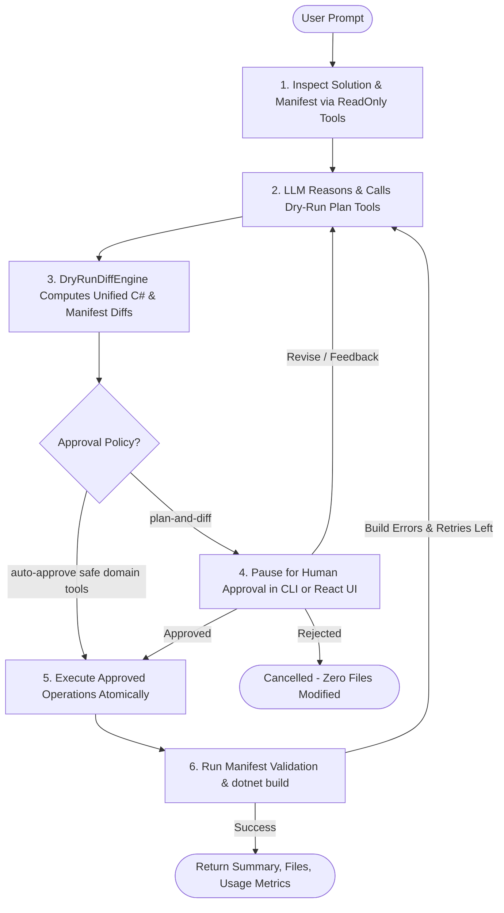

# 06 — Technical Specification: AI Agent Mode with Configurable Providers

> **Epistemic Status**: Grounded in verified `.NET 10` libraries (`Microsoft.Extensions.AI`, `Microsoft.Agents.AI`, `OpenAI`, `Azure.AI.OpenAI`, `Anthropic`, `Google.GenAI`, `OllamaSharp`) and agreed **Assumptions** (domain-tool-driven default with plan/diff preview and HITL approval; secret hygiene).

---

## 1. Unified Agent Architecture (`Mma.Cli.Agent`)

One shared agent runtime powers two surfaces:
1. **CLI / Interactive TUI (`mma agent`)**:
   - Interactive chat loop (`mma agent`) powered by `Spectre.Console` (markdown panels, diff views, yes/no/edit approval prompts).
   - One-shot or scripted runs (`mma agent "Create Order and OrderItem entities with 1:N relation" --profile anthropic-sonnet --dry-run`).
2. **React UI Copilot Drawer (`Mma.Cli.Bff` -> `Mma.Cli.Web`)**:
   - Streaming SSE conversation bound to the currently open solution, rendering structured **Plan Cards**, **Unified Diff Previews**, and **Approve / Reject / Revise** actions inline alongside the ERD canvas.

---

## 2. Configurable Multi-Provider Layer (`Microsoft.Extensions.AI`)

Every provider resolves to Microsoft's standard **`IChatClient`** abstraction, allowing identical tool calling, streaming, telemetry, caching, and middleware regardless of backend vendor.

### 2.1 First-Class Provider Matrix

| Provider Key (`type`) | NuGet SDK Package | `IChatClient` Adapter | Auth / Secret Mechanism | Key Capabilities |
| --- | --- | --- | --- | --- |
| `openai` | `OpenAI` + `Microsoft.Extensions.AI.OpenAI` | `OpenAIClient(...).GetChatClient(model).AsIChatClient()` | API Key (`OPENAI_API_KEY` or OS Keyring) | Tool calling, structured JSON, vision (ERD image import) |
| `anthropic` | `Anthropic` (v10+ official SDK) | `new AnthropicClient(...).AsIChatClient(model)` | API Key (`ANTHROPIC_API_KEY` or OS Keyring) | Tool calling, long context, vision |
| `gemini` | `Google.GenAI` (official SDK) | `new Client(...).AsIChatClient(model)` | API Key (`GEMINI_API_KEY` or OS Keyring) | Tool calling, multimodal ERD input |
| `azure-openai` | `Azure.AI.OpenAI` + `Azure.Identity` | `AzureOpenAIClient(...).GetChatClient(deployment).AsIChatClient()` | `DefaultAzureCredential` (Entra ID) or API Key | Enterprise RBAC / private endpoints |
| `ollama` | `OllamaSharp` | `new OllamaApiClient(uri, model)` (implements `IChatClient`) | None (local `http://localhost:11434`) | **Air-gapped / Local-only privacy mode** |
| `openai-compatible` | `OpenAI` + `Microsoft.Extensions.AI.OpenAI` | `OpenAIClient` with custom `OpenAIClientOptions { Endpoint = ... }` | Custom API key or local token | OpenRouter, LM Studio, vLLM, Groq, DeepSeek |

### 2.2 Middleware Pipeline (`ChatClientBuilder`)

Every resolved `IChatClient` passes through a uniform middleware chain in `LlmProviderFactory`:

```text
[ Concrete Provider IChatClient ]
  -> UseOpenTelemetry()            # Traces latency, model ID, finish reason
  -> ResiliencePipeline            # Exponential backoff on 429/503 via Microsoft.Extensions.Http.Resilience
  -> TokenAndCostBudgetMiddleware  # Enforces per-turn & per-session token/cost caps
  -> ToolApprovalInterceptor       # Enforces ReadOnly vs. WorkspaceWrite approval gates
  -> UseFunctionInvocation()       # Automatic structured tool-call loop
```

### 2.3 Layered Configuration Schema & Secret Hygiene

- **Global User Config**: `~/.mma/config.json` (user provider profiles, default profile, global MCP trust settings).
- **Solution-Local Config**: `.mma/config.json` inside the solution root (safe to commit to Git — overrides default profile/model or privacy mode, **never stores secrets**).
- **Secret Resolution Precedence**:
  1. Explicit `env:MY_ENV_VAR` reference in profile (`apiKeyRef: "env:ANTHROPIC_API_KEY"`).
  2. OS Keyring (`keyring:<profileId>` backed by Windows Credential Manager / DPAPI, macOS Keychain, or Linux SecretService/encrypted store).
  3. Interactive masked prompt in `mma config provider` or UI Settings (never echoed in logs).
- **Hard Guardrail**: `ConfigValidator` rejects any `.mma/config.json` containing literal `apiKey` fields or common key prefixes (`sk-`, `sk-ant-`, `AIza`) and emits a security warning.

#### Example `~/.mma/config.json`

```json
{
  "schemaVersion": 2,
  "defaultProfile": "claude-sonnet",
  "providers": {
    "claude-sonnet": {
      "type": "anthropic",
      "model": "claude-sonnet-4-5",
      "apiKeyRef": "keyring:claude-sonnet",
      "temperature": 0.1,
      "maxOutputTokens": 4096
    },
    "gpt-default": {
      "type": "openai",
      "model": "gpt-4o",
      "apiKeyRef": "env:OPENAI_API_KEY"
    },
    "gemini-flash": {
      "type": "gemini",
      "model": "gemini-2.5-flash",
      "apiKeyRef": "env:GEMINI_API_KEY"
    },
    "local-qwen": {
      "type": "ollama",
      "baseUrl": "http://127.0.0.1:11434",
      "model": "qwen2.5-coder:14b",
      "localOnly": true
    },
    "openrouter": {
      "type": "openai-compatible",
      "baseUrl": "https://openrouter.ai/api/v1",
      "model": "anthropic/claude-3.7-sonnet",
      "apiKeyRef": "env:OPENROUTER_API_KEY"
    }
  },
  "agent": {
    "approvalPolicy": "plan-and-diff",
    "maxStepsPerTurn": 12,
    "maxTokensPerSession": 120000,
    "allowArbitraryFileEdits": false,
    "allowShellCommands": false,
    "redactConnectionStrings": true
  }
}
```

---

## 3. Agent Execution Loop, Tools & HITL Approval (`Microsoft.Agents.AI`)



### 3.1 Tool Risk Classification Matrix

| Tier | Tools Included | Default Behavior | Overridable? |
| --- | --- | --- | --- |
| **Tier 0 — ReadOnly** | `inspect_solution`, `list_entities`, `get_entity_details`, `validate_project`, `list_templates`, `introspect_database`, `build_solution`, `plan_*` (dry-run) | Auto-executed without prompting | Always allowed |
| **Tier 1 — Domain Write** | `create_solution`, `add_entity`, `remove_entity`, `add_property`, `remove_property`, `add_relation`, `remove_relation`, `apply_manifest`, `import_database_schema`, `create_ef_migration` | Generates dry-run diff first; **pauses for user approval** | Yes (`--auto-approve` in CLI or `auto-approve` policy) |
| **Tier 2 — Opt-In Code/Shell** | `patch_solution_file` (jailed to solution), `run_dotnet_test` | **Disabled by default** (`allowArbitraryFileEdits: false`) | Explicit opt-in + per-action confirmation |
| **Tier 3 — External MCP** | Phase 2 `ext_<server>_<tool>` tools | Follows `RequiresApproval` unless marked read-only in user allow-list | Per-server policy in `~/.mma/mcp.json` |

---

## 4. Security, Privacy & Reliability Guardrails

1. **Workspace Path Jailing**: Every file or solution path passed to a tool is resolved via `Path.GetFullPath` and verified to reside inside the active workspace root; `..` traversal or external OS paths are rejected.
2. **Sensitive Data Redaction**: Before passing DB inspection results or config files into a cloud `IChatClient`, `ContextRedactor` strips SQL/Postgres connection strings, passwords, bearer tokens, and `appsettings.*.json` secrets—leaving only structural schema metadata.
3. **Local-Only Privacy Mode**: Users can enforce `privacyMode: "local-only"` in `.mma/config.json`, which refuses any cloud provider profile and permits only `ollama` or loopback `openai-compatible` endpoints.
4. **Prompt Injection Defense**: Database table/column comments, existing C# file contents, and external MCP tool outputs are wrapped in explicit untrusted-data boundaries (`<external_data>...</external_data>`) in system instructions, and destructive actions remain gated by the deterministic `ApprovalGate` (not LLM self-judgment).
5. **Circuit Breakers & Cost Control**: Hard caps on `maxStepsPerTurn` (default 12), `maxTokensPerSession`, and automatic retry limit (`maxBuildFixAttempts: 2`) prevent infinite LLM self-repair loops.
6. **Git Checkpoint Integration (Recommended)**: Optional `--git-checkpoint` flag creates a lightweight pre-apply commit or stash marker before executing an approved agent plan for one-command rollback.

---

## 5. Persistence, Telemetry & Deterministic Testing

- **Session Store (`workspace.db`)**: Stores `AgentSession`, `AgentMessage`, `ToolInvocationAudit` (tool name, args hash, duration, approval decision), and `TokenUsageRecord` (input/output tokens, provider, model).
- **Deterministic Test Suite (`Mma.Cli.Agent.Tests`)**:
  - Uses a scripted `FakeChatClient : IChatClient` inside xUnit to test multi-turn tool loops, plan generation, `ApprovalGate` rejection (verifying zero disk writes), approval execution, build-failure auto-fix retry cap, connection-string redaction, and plaintext-key rejection—without hitting live paid LLM APIs.
  - Optional manual smoke-test profile (`[Trait("Category", "LiveProvider")]`) gated behind explicit env vars for periodic validation against OpenAI, Anthropic, Gemini, and Ollama.
